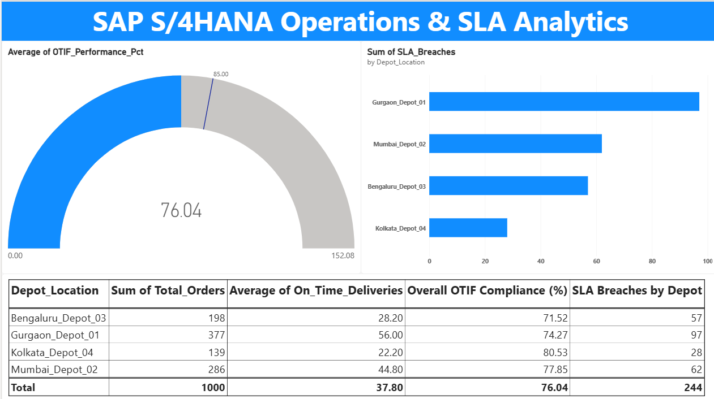
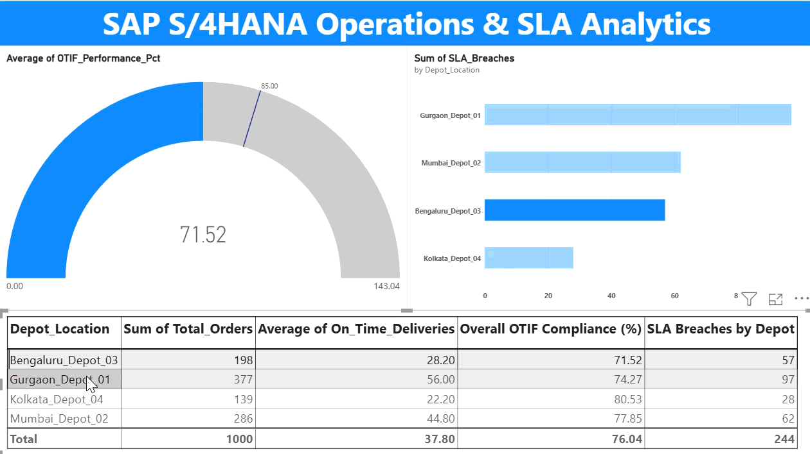

# SAP S/4HANA Operations Analytics & SLA Dashboard

An end-to-end operational analytics pipeline and interactive Power BI dashboard that extracts SAP S/4HANA logistics data, executes SQL-driven SLA metrics aggregation, and flags depot-level delivery breaches.




---

## 📌 Executive Summary
This project models real-time logistics analytics for an enterprise SAP S/4HANA deployment. It ingests order fulfillment datasets, calculates key metrics such as **On-Time In-Full (OTIF) %**, identifies operational latency across regional depots, and isolates SLA breaches for supply chain decision-makers.

---

## 🛠️ Repository Architecture & File Structure

```text
sap-operations-analytics/
├── SAP_Operations_Analytics_Dashboard.pbix  # Interactive Power BI Report
├── generate_sap_data.py                    # Synthetic SAP S/4HANA Order Data Generator
├── process_sap_data.py                     # SQL Aggregation Engine & SLA Breach Logic
├── fetch_sap_sandbox.py                    # SAP Business Accelerator Hub API Integration
├── Automate_SLA_Report.bas                 # VBA Macro for Executive Excel Formatting
├── sap_operations.db                       # Local SQLite Relational SAP Database
├── sap_sla_kpi_summary.csv                 # Processed KPI Summary Export
├── dashboard_preview.png                   # Dashboard Visual Preview
├── sap_operations_dashboard_demo.gif       # Interactive Dashboard Demo
└── README.md                               # Project Documentation
```

## Key Features & Architecture
1. **Cloud & Telemetry Ingestion (`fetch_sap_sandbox.py` & `generate_sap_data.py`):** 
   - Queries live SAP S/4HANA Cloud REST APIs (`API_SALES_ORDER_SRV`) via OData protocol.
   - Generates multi-table relational ERP schemas (`VBAK` Sales Headers, `LIKP` Delivery Notes) in SQLite.
2. **SQL Analytics Engine (`process_sap_data.py`):** 
   - Aggregates fulfillment metrics, calculates OTIF %, and flags regional depot SLA breaches.
3. **VBA Report Automation (`Automate_SLA_Report.bas`):** 
   - Formats raw audit output, applies conditional executive styling, and highlights compliance breaches (<85% OTIF).

## Tech Stack
- **ERP Data Schemas:** SAP S/4HANA (`VBAK`, `VBAP`, `LIKP`, `LIPS`)
- **Protocols & APIs:** REST API, OData, SAP Business Accelerator Hub
- **Languages & Tools:** Python 3.x, SQL (SQLite), Excel VBA, Git/GitHub
- **Data Analytics:** Data Pipelines, SLA Tracking, Operational Bottleneck Identification

## Project Setup & Execution

```bash
# 1. Ingest Data (Choose Option A or B)
# Option A: Ingest Live SAP Sandbox Data via OData API
python fetch_sap_sandbox.py

# Option B: Generate Local Relational SAP Database
python generate_sap_data.py

# 2. Run SQL KPI Aggregation & OTIF Analysis
python process_sap_data.py

# 3. Format Audit Dashboard in Excel
# Open sap_sla_kpi_summary.csv in Excel and run macro Automate_SLA_Report.bas